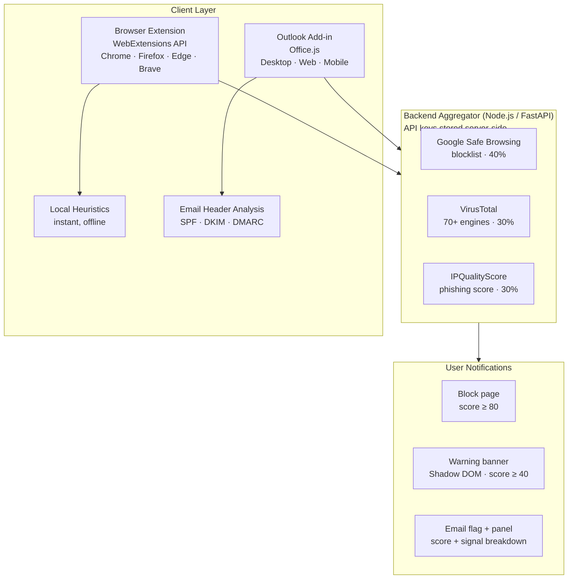

<div align="center">


**Cross-browser extension + Outlook add-in for real-time phishing and threat detection.**


[](https://github.com/dzenan27)

<br/>


<br/>

**Jump to:**
[Overview](#overview) • [Demo](#demo) • [Architecture](#architecture) • [Detection](#detection) • [Thresholds](#thresholds) • [Coverage](#coverage) • [Limitations](#limitations) • [Setup](#setup) • [Files](#files)

</div>

---

<a id="overview"></a>
## 🔍 What This Does

DeZerra Shield intercepts every URL a user visits and every email they open, runs it through a multi-layer detection pipeline, and alerts the user when a phishing or malware threat is detected.

- ⚡ **Layer 1:** Local heuristics that run instantly and offline
- 🌐 **Layer 2:** Weighted threat-intel scoring from Google Safe Browsing, VirusTotal, and IPQualityScore
- 📧 **Layer 3:** Email authentication checks (SPF, DKIM, DMARC) inside Outlook
- 🔐 **API keys stay server-side**, never shipped inside the extension

---

<a id="demo"></a>
## 🎬 Demo Walk-Through

https://github.com/user-attachments/assets/56b0920b-dc00-4ff0-ad5d-d0bebe604880

---

<a id="architecture"></a>
## 🏗️ System Architecture



<details>
<summary><b>Text version</b></summary>

<br/>

```
CLIENT LAYER
├── Browser Extension (WebExtensions API — Chrome, Firefox, Edge, Brave)
│   ├── Local Heuristics (instant, offline)
│   └── → Backend API Aggregator
└── Outlook Add-in (Office.js — Desktop, Web, Mobile)
    ├── Email Header Analysis (SPF/DKIM/DMARC)
    └── → Backend API Aggregator

YOUR BACKEND (Node.js / FastAPI)
└── API Keys stored server-side (never in the extension)
    ├── Google Safe Browsing  — blocklist, 40% weight
    ├── VirusTotal            — 70+ engine consensus, 30% weight
    └── IPQualityScore        — dedicated phishing score, 30% weight

USER NOTIFICATIONS
├── Block page  — full redirect for score ≥ 80
├── Warning banner — injected via Shadow DOM for score ≥ 40
└── Email flag + panel — threat score + signal breakdown
```

</details>

---

<a id="detection"></a>
## 🧠 Detection Methodology

### ⚡ Layer 1 — Local Heuristics
*Runs instantly with no API call*

These checks run in under 1ms and catch threats that haven't reached threat intelligence feeds yet ("zero-day phishing").

| Check | What it detects | Cyber concept |
|---|---|---|
| HTTPS validation | Unencrypted connections | Transport security |
| Suspicious TLD | `.tk`, `.xyz`, `.click` etc | TLD abuse patterns |
| Brand impersonation | `paypal.evil.com` | Subdomain spoofing |
| Homoglyph detection | `pаypal.com` (Cyrillic а) | Unicode substitution attacks |
| URL entropy scoring | Algorithmically generated domains | DGA detection |
| Excessive subdomains | `secure.login.verify.paypal.evil.com` | URL obfuscation |
| Raw IP as hostname | `http://192.168.1.1/login` | Bulletproof hosting indicator |
| Credential keywords | `/login/verify/update` in path | Phishing page pattern |

### 🌐 Layer 2 — Threat Intelligence APIs
*Weighted aggregate*

| Source | Type | Weight | Why |
|---|---|---|---|
| Google Safe Browsing | Blocklist (binary) | **40%** | Highest trust, fed by billions of Chrome users |
| VirusTotal | Multi-engine consensus | **30%** | 70+ independent AV engines reduce false positives |
| IPQualityScore | Continuous risk score | **30%** | Domain age, DNS history, behavioral patterns |

**Score aggregation:**

```
final_score = (gsb × 0.40) + (vt × 0.30) + (ipqs × 0.30)
```

### 📧 Layer 3 — Email Authentication
*Outlook add-in*

| Protocol | What it checks | Failure meaning |
|---|---|---|
| **SPF** | Did this email come from an authorized server? | Sender IP not permitted by domain |
| **DKIM** | Was the email cryptographically signed? | Email may have been tampered in transit |
| **DMARC** | Does the domain have an enforcement policy? | Policy violated — likely spoofing |

---

<a id="thresholds"></a>
## 🚦 Threat Thresholds

| Score | Verdict | Action |
|---|---|---|
| 0–39 |  | Silent pass |
| 40–79 |  | Warning banner injected via Shadow DOM |
| 80–100 |  | Full-page block interstitial |

---

<a id="coverage"></a>
## 🗺️ Threat Coverage Matrix

| Attack type | Local heuristics | GSB | VirusTotal | IPQS | Email auth |
|---|---|---|---|---|---|
| Credential harvesting page | ✅ (keywords, entropy) | ✅ | ✅ | ✅ | — |
| Business email compromise | — | — | — | — | ✅ (Reply-To mismatch) |
| Lookalike domain | ✅ (homoglyph, brand check) | ✅ | ✅ | ✅ | ✅ (SPF/DKIM) |
| Drive-by malware download | — | ✅ (MALWARE type) | ✅ | ✅ | — |
| URL shortener redirect | ✅ (redirect chain) | ✅ | ✅ | ✅ | — |
| Raw IP hosting | ✅ (IP hostname check) | ✅ | ✅ | ✅ | — |
| Email spoofing | — | — | — | — | ✅ (DMARC fail) |
| DGA / algorithmically generated domain | ✅ (entropy) | ✅ | ✅ | ✅ | — |

---

<a id="limitations"></a>
## ⚠️ Known Limitations & False Positives

> Understanding where a tool fails is as important as knowing what it catches.

<details open>
<summary><b>🟡 False positives (safe sites flagged as threats)</b></summary>

<br/>

- Newly registered legitimate domains score high on entropy checks
- URL shorteners (bit.ly, t.co) trigger redirect chain detection
- Legitimate sites on free TLDs (.tk is used by some real businesses)
- Large enterprise internal URLs with many subdomain levels

</details>

<details open>
<summary><b>🔴 False negatives (threats not caught)</b></summary>

<br/>

- Freshly registered phishing domains not yet in GSB or VirusTotal
- Phishing pages hosted on legitimate compromised infrastructure (good domain reputation)
- Targeted spear-phishing with custom domains and valid TLS certificates
- Adversary-in-the-middle (AiTM) proxy phishing kits that relay real sites

</details>

**🛡️ Mitigation:** The multi-source weighted scoring model reduces both error types — a URL must look suspicious to multiple independent sources before triggering a block. Local heuristics catch what APIs miss; APIs catch what heuristics miss.

---

<a id="setup"></a>
## ⚙️ Setup

<details open>
<summary><b>🧩 Browser extension</b></summary>

<br/>

1. Clone this repo
2. Open `chrome://extensions/`
3. Enable **Developer mode**
4. Click **Load unpacked** → select the `phishing-detector/` folder
5. Add your API keys to `background/config.js` (or deploy the backend and point `BACKEND_URL` to it)

</details>

<details>
<summary><b>📧 Outlook add-in</b></summary>

<br/>

```bash
cd outlook-addin
npm install -g yo generator-office
yo office
# Choose: Outlook task pane
npm start
```

</details>

<details>
<summary><b>🖥️ Backend</b></summary>

<br/>

```bash
cd backend
pip install fastapi uvicorn httpx
export GOOGLE_SAFE_BROWSING_KEY="..."
export VIRUSTOTAL_KEY="..."
export IPQUALITYSCORE_KEY="..."
uvicorn server:app --reload
```

Deploy to Railway: `railway up`

</details>

### 🔑 API keys (free tiers)

| API | Free tier | Link |
|---|---|---|
| Google Safe Browsing | 10,000 requests/day | [console.cloud.google.com](https://console.cloud.google.com) |
| VirusTotal | 4 requests/min | [virustotal.com/gui/sign-in](https://www.virustotal.com/gui/sign-in) |
| IPQualityScore | 5,000 requests/month | [ipqualityscore.com](https://www.ipqualityscore.com) |

---

<a id="files"></a>
## 📁 Project Files

```
phishing-detector/
├── manifest.json                  # Extension identity + permissions
├── background/
│   ├── service_worker.js          # Navigation interception + orchestration
│   ├── api_detection.js           # External threat API calls
│   └── config.js                  # API keys + scoring weights
├── content/
│   └── content_script.js          # Shadow DOM banner injection
├── heuristics/
│   └── url_heuristics.js          # Local offline detection logic
├── popup/
│   ├── popup.html                 # Extension popup UI
│   ├── popup.js                   # Popup data rendering
│   └── log.html                   # Threat log viewer
├── outlook-addin/
│   ├── taskpane.html              # Outlook task pane UI
│   └── taskpane.js                # Email analysis + Office.js integration
└── backend/
    └── server.py                  # FastAPI aggregator + threat log
```

---

<div align="center">

*DeZerra Shield is a portfolio and educational project demonstrating multi-layer phishing detection. It is not a commercial security product.*

[](https://github.com/dzenan27)
[](https://www.linkedin.com/in/dzenanm)


</div>
